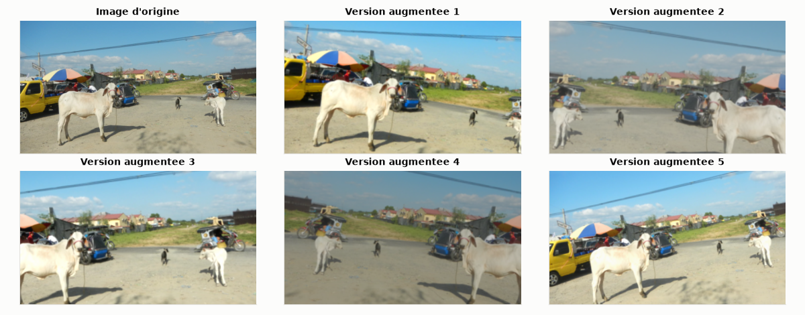
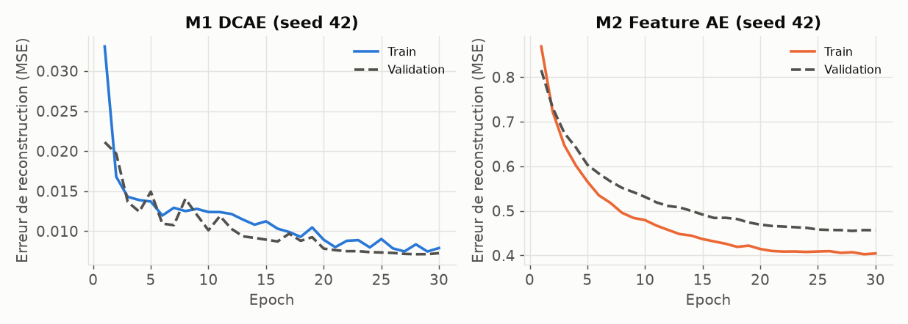
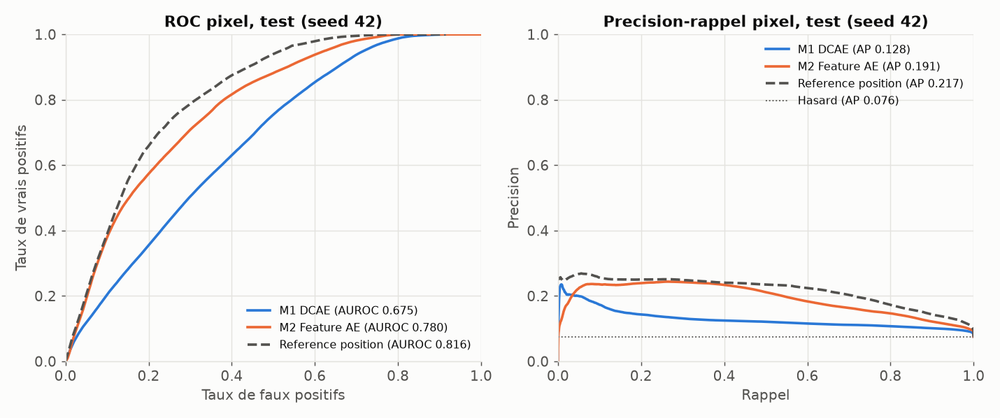
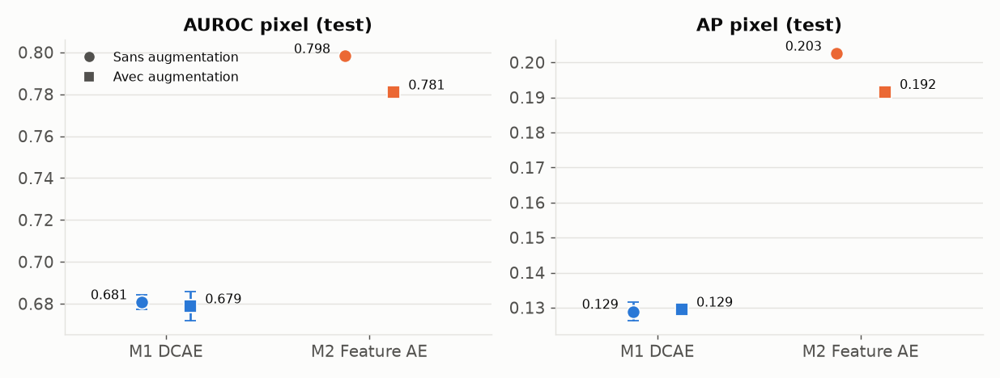
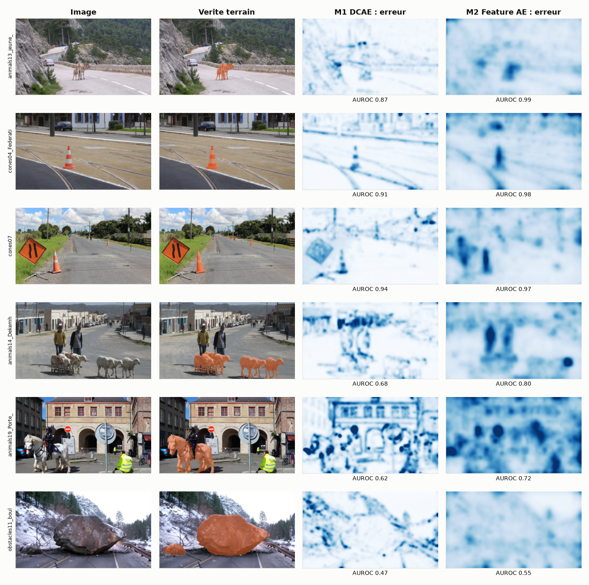

# Rapport individuel : Yassine Hammouda
## BO3 : détecter des objets jamais vus, sans étiquettes d'anomalies

Projet Deep Learning RoadAnomaly · Branche `yassine` · Dépôt `GhassenChaouch/RoadAnomaly`

> **En bref.** Deux autoencodeurs ont été entraînés sans aucun masque d'anomalie. Le meilleur, un autoencodeur de features ResNet18 (M2), atteint un AUROC pixel de **0,781** et une AP pixel de **0,192**, contre **0,679** et **0,129** pour un autoencodeur convolutif débruitant sur les pixels (M1). L'écart est statistiquement fiable. Mais M2 reste sous une simple référence de position (AUROC 0,816, AP 0,217) en score global, loin du supervisé (Dice 0,297 contre 0,832), et l'augmentation n'apporte aucun gain mesurable.

---

## 1. Objectif métier

### 1.1 Le BO3
Le projet comporte trois objectifs métier. Le BO3 pose la question la plus difficile : **peut-on repérer un obstacle sans jamais avoir montré à quoi ressemble un obstacle ?**

En pratique, un système de perception ne peut pas avoir vu tous les objets possibles sur une route. Un modèle supervisé apprend à reconnaître ce qu'on lui a étiqueté ; le BO3 cherche à détecter ce qui sort de l'ordinaire, sans étiquette d'anomalie à l'entraînement.

### 1.2 Critères fixés par le BO3
| Critère du BO3 | Comment il est traité ici |
|---|---|
| Aucune étiquette d'anomalie à l'entraînement | Le code d'entraînement ne lit jamais les masques (section 5.1) |
| AUROC au niveau pixel | Calculé sur tous les pixels du test (section 7) |
| Précision moyenne (AP) au niveau pixel | Calculée sur tous les pixels du test (section 7) |
| 2 modèles techniquement différents | M1 travaille sur les pixels, M2 sur des features pré-entraînées |
| Discussion : résultat plus faible que le supervisé | Section 9 |

### 1.3 Remarque du professeur sur les données
Le professeur a proposé d'ajouter un dataset ou, à défaut, d'augmenter le dataset existant par rotation, flip, etc. **Le dataset n'a pas été complété : c'est l'augmentation qui a été retenue**, et son effet a été mesuré (section 8.3).

---

## 2. Données

| Élément | Valeur |
|---|---|
| Dataset | RoadAnomaly (Lis et al., ICCV 2019) |
| Images | 60 scènes routières, 1280×720 |
| Masques | `labels_semantic.png`, anomalie = valeur 2 |
| Découpage | `split.csv` commun à l'équipe : 36 train / 12 validation / 12 test |
| Résolution de travail | 512×288, comme le protocole d'Ahmed |
| Pixels d'anomalie dans le test | 7,57 % |

**Limite centrale du dataset pour ce BO.** Les 60 images contiennent toutes au moins une anomalie. Il n'existe donc aucune image « normale » pure. L'entraînement se fait sur des images **contaminées**, mais sans étiquettes : le modèle ne sait pas où sont les anomalies. L'hypothèse est que celles-ci étant minoritaires en pixels, il apprend surtout la route et le décor. Il peut toutefois apprendre aussi un peu à reconstruire les anomalies, ce qui peut pénaliser les scores.

### Augmentation appliquée (entraînement uniquement)
| Transformation | Paramètre | Raison |
|---|---|---|
| Flip horizontal | Probabilité 50 % | Une route reste plausible en miroir |
| Rotation | ±10° avec bords en miroir | Bords en miroir pour ne pas apprendre des coins noirs |
| Zoom aléatoire | Recadrage de 70 à 100 %, ratio 16:9 | Variété d'échelle |
| Luminosité, contraste, saturation | ±20 % | Conditions d'éclairage |



Chaque epoch traite 144 images (36 images × 4 passages), avec ou sans augmentation, afin que la comparaison se fasse **à budget d'entraînement égal**.

---

## 3. Principe de la méthode

Un autoencodeur compresse son entrée puis la reconstruit. Entraîné sur des scènes routières, il devrait bien reconstruire ce qui y est fréquent et mal reconstruire ce qui est inhabituel.

```text
Image -> Encodeur -> Goulot (information réduite) -> Décodeur -> Reconstruction
Score d'anomalie d'un pixel = erreur de reconstruction à cet endroit
```

La carte d'erreur est lissée par un filtre gaussien (σ = 4 pixels) à 512×288. Plus un pixel a une erreur élevée, plus il est jugé anormal.

---

## 4. Les deux modèles

### 4.1 Présence dans la liste du cours

| Élément | Chapitre | Statut |
|---|---|---|
| **M1 :** autoencodeur convolutif | Chap. 5 | Dans la liste |
| **M1 :** autoencodeur débruitant | Chap. 5 | Dans la liste |
| **M2 :** ResNet (ici ResNet18) | Chap. 4 | Dans la liste |
| **M2 :** autoencodeur profond | Chap. 5 | Dans la liste |
| **M2 :** ResNet + autoencodeur sur features | | **Pas tel quel dans la liste : assemblage de deux éléments du cours** |
| Conv2D, ReLU, MSE, early stopping | Chap. 2 à 4 | Dans la liste |
| Weight decay (AdamW = Adam + L2) | Chap. 3 | Adam et L2 sont dans la liste |
| Batch Normalization | | **Hors de la liste** |
| Planning cosinus du learning rate | | **Hors de la liste** |
| Convolution transposée | Chap. 5 (décodeur) | Non détaillée dans le texte extrait du cours |

### 4.2 M1 : autoencodeur convolutif débruitant

| Propriété | Valeur |
|---|---|
| Entrée | Image RGB 3×288×512, dans [0, 1] |
| Encodeur | 5 convolutions stride 2 : 32, 64, 128, 192, 64 canaux |
| Goulot | 64×9×16 = 9 216 valeurs, soit une compression de 48:1 |
| Décodeur | 5 convolutions transposées, sortie sigmoïde |
| Débruitage | Bruit gaussien σ = 0,1 en entrée ; la cible reste l'image propre |
| Perte | MSE |
| Initialisation | Aléatoire |
| Paramètres | 1,18 M |
| Fichier de poids | 4,75 Mo |

**Pourquoi le débruitage ?** Il force le modèle à apprendre la structure des scènes plutôt qu'à recopier l'entrée.

### 4.3 M2 : autoencodeur de features ResNet18

| Propriété | Valeur |
|---|---|
| Extracteur | ResNet18 ImageNet **gelé**, couches 1 à 3 |
| Features | 64 + 128 + 256 = 448 canaux, réduits à la résolution 1/8 (36×64) |
| Prétraitement | Standardisation canal par canal, estimée sur le train |
| Autoencodeur | Convolutions 1×1 : 448 → 224 → 128 → 64 → 128 → 224 → 448 |
| Perte | MSE sur les features standardisées |
| Paramètres entraînés | 1,60 M |
| Fichier de poids | 17,6 Mo, ResNet gelé inclus |

**Pourquoi des features ?** Une erreur sur les pixels réagit aux contours et aux textures fines. Une erreur sur des features décrit des différences de contenu visuel.

**Réserve.** ImageNet contient des animaux et des véhicules. M2 n'utilise aucune étiquette d'anomalie **de ce projet**, mais ses features ne sont pas vierges de ces objets, ce qui peut l'aider sur les animaux.

### 4.4 Ce qui rend les deux modèles techniquement différents
| | M1 | M2 |
|---|---|---|
| Espace de reconstruction | Pixels | Features profondes |
| Initialisation | Aléatoire | Extracteur pré-entraîné sur ImageNet |
| Spatialité du goulot | Compression spatiale | Compression du vecteur en chaque position |
| Résolution native de l'erreur | Pixel | 1/8 de l'image |

---

## 5. Le code

| Fichier | Rôle |
|---|---|
| `BO3_train_eval.py` | Données, augmentation, modèles, entraînement, métriques |
| `BO3_analysis.py` | Agrégation des 12 runs, bootstrap, référence de position, figures |
| `outputs_bo3/runs/<modele>_aug<0/1>_seed<s>/` | `results.json`, `history.csv` de chaque run |
| `outputs_bo3/` | Tableaux et figures de la comparaison |

Les poids (`*.pt`) et les cartes d'anomalies (`maps_*.npy`) ne sont pas versionnés.

### 5.1 Garantie « sans étiquettes »
L'entraînement ne charge que les images. Les masques apparaissent uniquement après la fin de la boucle :

```python
train_images = [load_image(n) for n in names["train"]]  # aucune lecture de masque ici
# ... boucle d'entraînement, early stopping sur l'erreur de reconstruction ...
# Les masques n'entrent en jeu qu'a partir d'ici.
masks = {s: [load_mask(n) for n in names[s]] for s in ("val", "test")}
```

Les masques de validation servent seulement à choisir un seuil pour les métriques complémentaires (Dice, précision, rappel). **L'AUROC et l'AP ne dépendent d'aucun seuil.**

### 5.2 Entraînement
| Paramètre | Valeur |
|---|---|
| Optimiseur | AdamW, lr 1e-3, weight decay 1e-4 |
| Learning rate | Planning cosinus |
| Batch | 4 |
| Epochs | 30 au maximum, patience 8 |
| Sélection | Plus faible erreur de reconstruction en validation |
| Matériel | NVIDIA GeForce GTX 1650 (4 Go), PyTorch 2.11 CUDA 12.8 |

### 5.3 Score d'anomalie
```python
err = model.reconstruction_error(image.unsqueeze(0).to(device))
err = F.interpolate(err, size=(H, W), mode="bilinear", align_corners=False)
return gaussian_blur(err).squeeze().cpu().numpy()
```

---

## 6. Protocole expérimental : pourquoi 12 runs

**2 modèles × 2 conditions (avec et sans augmentation) × 3 seeds (42, 43, 44) = 12 entraînements**, chacun évalué sur les 12 images de test.

- Les **seeds** mesurent la variabilité due au hasard de l'entraînement.
- Le **bootstrap** (2 000 tirages des images de test, IC à 95 %) mesure l'incertitude due au petit nombre d'images de test.
- La **référence de position** est la moyenne lissée des masques du train. Elle indique où les anomalies se trouvent en général. **Elle utilise des étiquettes : c'est un point de repère, pas un concurrent non supervisé.**

Chaque run a duré entre 47 et 102 secondes.



Les 30 epochs ont été utilisées à chaque run : l'arrêt anticipé ne s'est pas déclenché. Les meilleures epochs sont proches de la fin (26,7 en moyenne pour M1, 29,3 pour M2), avec des courbes déjà presque plates.

---

## 7. Résultats de chaque modèle

Toutes les valeurs sont sur le test : moyenne ± écart-type sur 3 seeds. Le Dice, la précision et le rappel utilisent un seuil choisi sur la validation.

### 7.1 M1 : autoencodeur convolutif débruitant

| | AUROC pixel | AP pixel | Faux positifs à 95 % de rappel | Dice | Précision | Rappel |
|---|---|---|---|---|---|---|
| Avec augmentation | 0,679 ± 0,007 | 0,129 ± 0,001 | 0,710 | 0,187 | 0,129 | 0,347 |
| Sans augmentation | 0,681 ± 0,003 | 0,129 ± 0,003 | 0,705 | 0,188 | 0,129 | 0,347 |

### 7.2 M2 : autoencodeur de features ResNet18

| | AUROC pixel | AP pixel | Faux positifs à 95 % de rappel | Dice | Précision | Rappel |
|---|---|---|---|---|---|---|
| Avec augmentation | 0,781 ± 0,001 | 0,192 ± 0,001 | 0,621 | 0,297 | 0,213 | 0,492 |
| Sans augmentation | 0,798 ± 0,001 | 0,203 ± 0,000 | 0,556 | 0,301 | 0,222 | 0,470 |

---

## 8. Comparaison

### 8.1 Tableau (avec augmentation)

| Critère | M1 | M2 | Référence de position |
|---|---|---|---|
| AUROC pixel | 0,679 | 0,781 | **0,816** |
| IC 95 % de l'AUROC | 0,594 à 0,787 | 0,670 à 0,906 | |
| AP pixel | 0,129 | 0,192 | **0,217** |
| IC 95 % de l'AP | 0,098 à 0,183 | 0,146 à 0,298 | |
| Faux positifs à 95 % de rappel | 71,0 % | 62,1 % | **51,8 %** |
| AUROC moyen par image | 0,743 | **0,869** | 0,834 |
| AP moyenne par image | 0,169 | **0,357** | 0,257 |
| Dice | 0,187 | 0,297 | **0,325** |
| Obstacles détectés à ≥ 50 % | 6/12 | 8/12 | 10/12 |
| Fausses alertes (surface d'image) | 17,9 % | 13,8 % | 17,5 % |
| Inférence CPU | **30 ms** | 98 ms | |
| Inférence GPU | **4 ms** | 9 ms | |
| Durée d'entraînement | 1,3 min | 1,5 min | |

L'AP du hasard vaut 0,076, soit la proportion de pixels d'anomalie.



### 8.2 M2 contre M1
Sur les runs avec augmentation, l'écart M2 − M1 est de **+0,10 d'AUROC (IC 95 % : +0,058 à +0,157)** et de **+0,06 d'AP (IC 95 % : +0,023 à +0,146)**. Les deux intervalles excluent zéro : M2 est meilleur que M1 sur ce test. Cet intervalle porte sur ces données et ces 12 images, pas sur toutes les routes.

M2 a un coût : environ 3 fois plus lent en inférence sur CPU et un fichier de poids plus lourd.

### 8.3 Effet de l'augmentation



| Modèle | Gain d'AUROC (avec − sans) | IC 95 % | Gain d'AP | IC 95 % |
|---|---|---|---|---|
| M1 | −0,002 | −0,009 à +0,005 | +0,001 | −0,003 à +0,003 |
| M2 | −0,017 | −0,037 à +0,004 | −0,011 | −0,023 à +0,004 |

**Aucun gain mesurable.** Les intervalles incluent zéro. Pour M2, la tendance est même légèrement défavorable. Une hypothèse, non testée ici : le modèle apprend aussi à bien reconstruire des versions transformées, ce qui le rend plus tolérant à l'inhabituel. L'augmentation à elle seule ne semble donc pas être le levier adapté à ce BO.

### 8.4 Analyse par type d'obstacle (avec augmentation)

| Groupe | Images | AUROC M1 | AUROC M2 | AP M1 | AP M2 |
|---|---|---|---|---|---|
| Animaux | 6 | 0,734 | 0,873 | 0,154 | 0,375 |
| Cônes | 2 | 0,922 | 0,972 | 0,185 | 0,396 |
| Obstacles | 3 | 0,601 | 0,780 | 0,115 | 0,267 |
| Autres (engin) | 1 | 0,860 | 0,908 | 0,381 | 0,438 |

| Taille | Images | AUROC M1 | AUROC M2 | AP M1 | AP M2 |
|---|---|---|---|---|---|
| Petite | 6 | 0,800 | 0,938 | 0,123 | 0,362 |
| Grande | 6 | 0,686 | 0,800 | 0,214 | 0,352 |

Ces sous-groupes sont très petits (parfois 1 ou 2 images) : ce sont des indications, pas des preuves.

### 8.5 Cas visuels

Les trois premières lignes montrent les images les mieux traitées par M2, les trois dernières les moins bien traitées.



**Ce qui se voit :**
- **Veau et cônes :** M2 place son erreur nettement sur l'objet. M1 est plus perturbé par les contours (rails, bord de route).
- **Scènes urbaines chargées** (`animals19`) : les deux modèles réagissent à tout le décor. Le cheval n'est pas mis en valeur.
- **Gros rocher** (`obstacles11_boulder5`, AUROC 0,48 pour M1 et 0,55 pour M2) : le pire cas. L'objet occupe 22,7 % de l'image et ses textures de roche sont proches du décor.
- **`animals14` :** M2 réagit aussi fortement aux piétons, qui ne sont pas annotés comme anomalies dans le masque. Une partie de ce qui est compté en faux positifs est donc un objet réellement saillant.

---

## 9. Discussion : non supervisé contre supervisé

| Modèle | Données d'entraînement | Dice test | Rappel | Précision |
|---|---|---|---|---|
| U-Net ResNet34 pré-entraîné (Ahmed) | Avec masques | **0,832** | 0,790 | 0,880 |
| U-Net ResNet34 from scratch (Ahmed) | Avec masques | 0,507 | 0,450 | 0,580 |
| Encodeur-décodeur CNN (Ahmed) | Avec masques | 0,421 | 0,776 | 0,289 |
| **M2 (BO3)** | **Sans masques** | **0,297** | 0,492 | 0,213 |
| **M1 (BO3)** | **Sans masques** | **0,187** | 0,347 | 0,129 |

Même découpage de test et même résolution. Comme attendu dans la définition du BO3, **le non supervisé est nettement moins bon**.

**Mais ce n'est pas la même tâche.** Le supervisé est excellent sur ce qui ressemble à ses exemples annotés. Le rapport d'Ahmed montre d'ailleurs son échec sur un engin de chantier absent de l'entraînement (`vehicle02`, rappel 0,076 à son seuil de rappel visé 90 %). Sur cette même image, M2 obtient un AUROC de 0,908. Les métriques n'étant pas identiques, cette observation unique indique seulement l'intérêt potentiel de l'approche, elle ne prouve pas une supériorité.

**La référence de position est le point le plus important à discuter.** En score global, elle dépasse M2. Une partie de la performance globale peut donc s'expliquer par le fait que les anomalies sont souvent au même endroit, et les modèles ne font pas encore mieux que ce simple a priori. M2 la dépasse en moyenne par image (AUROC 0,869 contre 0,834 ; AP 0,357 contre 0,257), mais cet écart n'a pas fait l'objet d'un test statistique.

### Conclusion pour le métier
Dans cet état, **aucun des deux modèles n'est utilisable pour une alerte de conduite** : M2 signale à tort 13,8 % de la surface de l'image et ne retrouve qu'un rappel de 0,492. L'intérêt du BO3 est ailleurs : mesurer ce qu'on peut faire sans annotations et confirmer que l'espace des features est plus adapté que l'espace des pixels.

---

## 10. Obstacles rencontrés

| Obstacle | Conséquence | Résolution |
|---|---|---|
| Aucune image sans anomalie | Pas de vrai apprentissage sur « normal » | Entraînement contaminé non étiqueté, limite déclarée |
| 60 images seulement, 12 en test | Forte incertitude | 3 seeds et intervalles de confiance par bootstrap |
| Clone Git impossible dans le dossier de session | « Filename too long » sous Windows | Clone dans `Desktop\RoadAnomaly` |
| Structure du dépôt réorganisée dans `RoadAnomaly-ahmed-unet/` | Chemins à réidentifier | Travail placé à côté des notebooks existants |
| Splits différents dans l'équipe (38/10/12 pour Arije, 36/12/12 pour Ahmed) | Comparaisons non directes | Choix du `split.csv` 36/12/12 |
| GPU non détecté au départ | `nvidia-smi` hors du PATH : PyTorch CPU installé à tort, temps estimé à 2 h | Détection de la GTX 1650, passage à PyTorch CUDA 12.8 |
| Entraînement interrompu à la fin d'une session | Un seul run terminé sur 12 | Relance capable de reprendre là où elle s'est arrêtée |
| Runs CPU et GPU à ne pas mélanger | Comparaison non homogène | Suppression des runs CPU partiels et reprise complète sur GPU |
| Erreur d'écriture ponctuelle d'une figure | Analyse arrêtée | Relance réussie |

---

## 11. Limites

1. **Test de 12 images :** intervalles larges, un sous-groupe peut ne contenir qu'une image.
2. **Contamination du train :** toutes les images d'entraînement contiennent des anomalies.
3. **Différence avec le papier de référence :** Lis et al. (2019) procèdent par resynthèse d'image à partir d'une segmentation sémantique. Ce travail utilise une approche plus simple par reconstruction : on suit le même objectif, pas la même méthode.
4. **Aucun réglage d'hyperparamètres avec les anomalies :** architecture, goulot et lissage ont été fixés a priori pour rester sans étiquettes. C'est volontaire, mais d'autres réglages pourraient donner de meilleurs résultats.
5. **Pas de dataset externe de scènes normales :** il n'a pas été testé.
6. **Annotations partielles :** certains objets saillants (piétons) ne sont pas annotés et comptent comme faux positifs.
7. **Bootstrap sur les images de test uniquement :** il ne couvre pas d'autres routes, caméras ou météo.
8. **Reproductibilité :** sur GPU, les résultats peuvent varier légèrement d'une exécution à l'autre, sans mode déterministe strict.
9. **Temps d'inférence :** mesurés sur une GTX 1650 et le CPU du PC ; ils ne prouvent pas une compatibilité avec un système embarqué.
10. **Prototype :** il n'est validé pour aucune décision de conduite réelle.

---

## 12. Perspectives

- Ajouter un dataset de routes sans anomalie, pour tester l'apprentissage sur données propres.
- Tester un VAE (chapitre 5) comme variante probabiliste.
- Combiner score d'erreur et a priori de position.
- Faire une validation croisée pour réduire la dépendance aux 12 images de test.
- Comparer à la méthode par resynthèse du papier de référence.

---

## 13. Reproduire le travail

### Dans VS Code, sous Windows
Ouvrir le dossier `RoadAnomaly-ahmed-unet/RoadAnomaly`, puis dans un terminal :

```powershell
python -m venv venv
venv\Scripts\activate
pip install torch torchvision --index-url https://download.pytorch.org/whl/cu128
pip install numpy pandas pillow scikit-learn scipy matplotlib
```

Entraîner un run :

```powershell
python BO3_train_eval.py --model feat --aug 1 --seed 42 --epochs 30 --out outputs_bo3/test_perso
```

Les 12 runs de la comparaison utilisent `--model {feat,dcae} --aug {0,1} --seed {42,43,44} --epochs 30`, puis :

```powershell
python BO3_analysis.py
```

`BO3_analysis.py` a besoin des fichiers `maps_*.npy` et ne fonctionne donc qu'après avoir refait les 12 runs sur la machine concernée.

### Dans Google Colab
Choisir un environnement GPU, puis :

```python
!git clone -b yassine https://github.com/GhassenChaouch/RoadAnomaly.git
%cd RoadAnomaly/RoadAnomaly-ahmed-unet/RoadAnomaly
!python BO3_train_eval.py --model feat --aug 1 --seed 42 --epochs 30 --out outputs_bo3/test_perso
```

Cette procédure Colab n'a pas été exécutée dans le cadre de ce travail.

---

## 14. Conclusion

Le BO3 a été traité selon ses critères : **deux modèles techniquement différents, aucune étiquette d'anomalie à l'entraînement, évaluation par AUROC et AP au niveau pixel, et discussion face au supervisé.**

M2, l'autoencodeur de features ResNet18, est le meilleur des deux, avec un écart statistiquement fiable face à M1. Mais aucun des deux modèles ne dépasse la référence de position en score global, l'augmentation n'apporte aucun gain mesurable, et le supervisé reste bien meilleur sur les obstacles déjà annotés. Ce résultat donne une réponse claire au BO3 : sans annotations, l'espace des features est un point de départ plus prometteur que celui des pixels, mais un apprentissage sur de vraies données normales et une méthode plus avancée seraient nécessaires pour une utilisation réelle.

---

## Références

- Lis, K., Nakka, K., Fua, P., Salzmann, M. *Detecting the Unexpected via Image Resynthesis*. ICCV 2019.
- He, K. et al. *Deep Residual Learning for Image Recognition*. CVPR 2016.
- Cours de Deep Learning, chapitres 2, 3, 4 et 5.
- Travaux de l'équipe : `RAPPORT_Ahmed.md`, `RAPPORT_Arije.md`.
