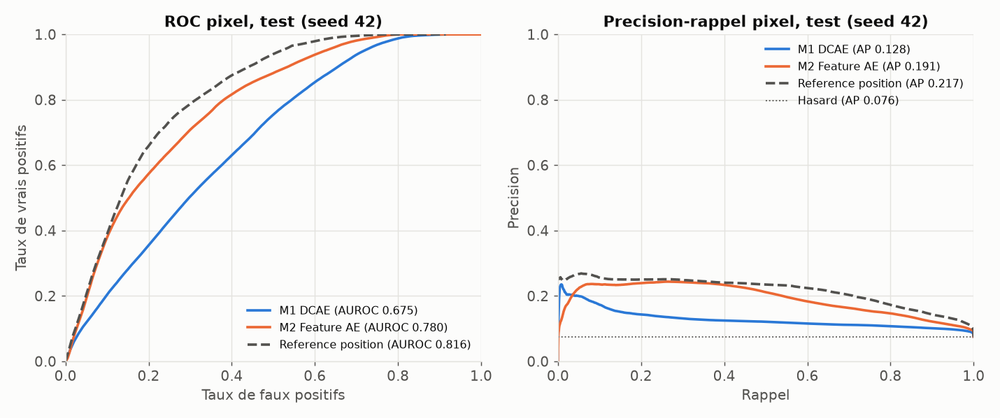
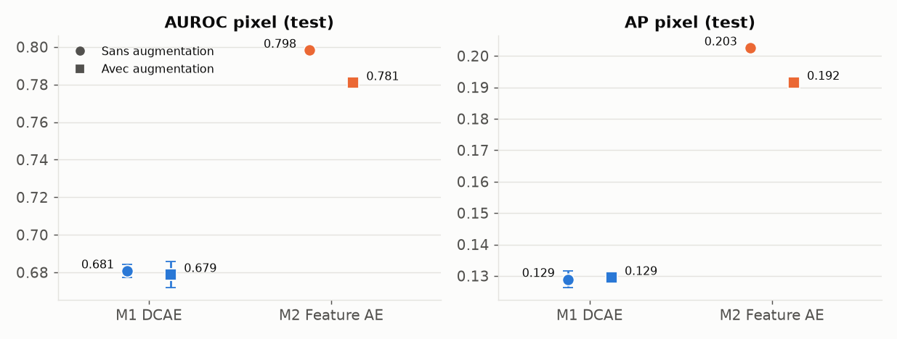
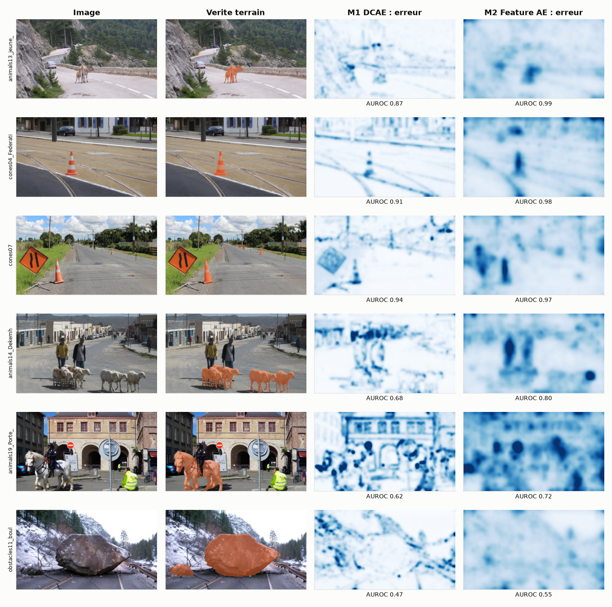

# Comparaison des modèles BO3 : détection d'objets jamais vus (RoadAnomaly)

*Tous les chiffres proviennent de `outputs_bo3/comparaison_bo3.csv` et `outputs_bo3/resume_statistique.json`, produits par `BO3_train_eval.py` et `BO3_analysis.py` (GPU GTX 1650). Détails complets : `RAPPORT_Yassine.md`.*

## 1. Objectif et protocole

Comparer deux autoencodeurs qui détectent les anomalies **sans aucune étiquette d'anomalie à l'entraînement**. Le score d'un pixel est son erreur de reconstruction.

| Élément | Choix |
|---|---|
| Découpage | `split.csv` commun : 36 train / 12 validation / 12 test |
| Part de pixels anormaux (test) | 7,57 % |
| Résolution | 512×288 |
| Augmentation (train seulement) | flip horizontal, rotation ±10° avec bords en miroir, zoom 70 à 100 %, luminosité / contraste / saturation ±20 % |
| Répétitions | 2 modèles × avec/sans augmentation × 3 seeds = 12 runs |
| Sélection du modèle | plus faible erreur de reconstruction en validation, sans masque |
| Seuil (Dice, précision, rappel) | choisi sur la validation ; AUROC et AP n'en dépendent pas |
| Métriques principales | AUROC et AP au niveau pixel, sur tout le test |
| Incertitude | écart-type sur 3 seeds et bootstrap à 95 % sur les 12 images de test |

**Référence de position :** moyenne lissée des masques du train. Elle utilise des étiquettes : c'est un point de repère, pas un concurrent non supervisé.

## 2. Les deux modèles

| Modèle | Description | Initialisation | Paramètres entraînés | Entraînement |
|---|---|---|---|---|
| **M1 : autoencodeur convolutif débruitant** | 5 convolutions / 5 convolutions transposées sur les pixels, goulot 64×9×16, bruit σ = 0,1 | aléatoire | 1,18 M | 30 epochs, AdamW lr 1e-3 |
| **M2 : autoencodeur de features** | Convolutions 1×1 sur 448 canaux de features ResNet18 (couches 1 à 3), goulot 64 canaux | ResNet18 ImageNet gelé, autoencodeur aléatoire | 1,60 M | 30 epochs, AdamW lr 1e-3 |

## 3. Résultats sur le test (12 images, moyenne de 3 seeds)

| Modèle | Augmentation | AUROC pixel | AP pixel | Faux positifs à 95 % de rappel | Précision | Rappel | Dice | IoU |
|---|---|---|---|---|---|---|---|---|
| M1 | oui | 0,679 ± 0,007 | 0,129 ± 0,001 | 0,710 | 0,129 | 0,347 | 0,187 | 0,103 |
| M1 | non | 0,681 ± 0,003 | 0,129 ± 0,003 | 0,705 | 0,129 | 0,347 | 0,188 | 0,104 |
| **M2** | oui | **0,781 ± 0,001** | **0,192 ± 0,001** | 0,621 | 0,213 | 0,492 | 0,297 | 0,175 |
| **M2** | non | **0,798 ± 0,001** | **0,203 ± 0,000** | 0,556 | 0,222 | 0,470 | 0,301 | 0,177 |
| Référence de position | | 0,816 | 0,217 | 0,518 | 0,218 | 0,642 | 0,325 | 0,194 |

AP du hasard : 0,076.

| | M1 | M2 |
|---|---|---|
| AUROC moyen par image | 0,743 | **0,869** |
| AP moyenne par image | 0,169 | **0,357** |
| Obstacles détectés à ≥ 50 % | 6/12 | 8/12 |
| Fausses alertes (surface d'image) | 17,9 % | 13,8 % |
| Inférence CPU | **30 ms** | 98 ms |
| Inférence GPU | **4 ms** | 9 ms |
| Fichier de poids | **4,75 Mo** | 17,6 Mo |

## 4. Analyse

### 4.1 Meilleur modèle : M2
- M2 dépasse M1 de **+0,10 d'AUROC (IC 95 % : +0,058 à +0,157)** et de **+0,06 d'AP (IC 95 % : +0,023 à +0,146)**, avec augmentation. Les intervalles excluent zéro sur ce test.
- Visuellement, il place mieux son erreur sur l'objet (veau, cônes), alors que M1 réagit davantage aux contours du décor (rails, bâtiments).
- Il coûte environ 3 fois plus cher en inférence sur CPU.

### 4.2 Augmentation : aucun gain mesurable
| Modèle | Gain d'AUROC | IC 95 % | Gain d'AP | IC 95 % |
|---|---|---|---|---|
| M1 | −0,002 | −0,009 à +0,005 | +0,001 | −0,003 à +0,003 |
| M2 | −0,017 | −0,037 à +0,004 | −0,011 | −0,023 à +0,004 |

### 4.3 Par type et taille d'obstacle (avec augmentation)
| Sous-groupe | Images | AUROC M1 | AUROC M2 |
|---|---|---|---|
| Animaux | 6 | 0,734 | 0,873 |
| Cônes | 2 | 0,922 | 0,972 |
| Obstacles | 3 | 0,601 | 0,780 |
| Engin (`vehicle02`) | 1 | 0,860 | 0,908 |
| Petites anomalies | 6 | 0,800 | 0,938 |
| Grandes anomalies | 6 | 0,686 | 0,800 |

Pire image : `obstacles11_boulder5` (gros rocher, 22,7 % de l'image), AUROC 0,48 pour M1 et 0,55 pour M2.

### 4.4 Face à la référence de position
En score global, **ni M1 ni M2 ne dépassent la référence de position**. M2 ne passe devant qu'en moyenne par image (AUROC 0,869 contre 0,834 ; AP 0,357 contre 0,257), sans test statistique sur cet écart.

### 4.5 Face au supervisé
| Modèle | Masques à l'entraînement | Dice test |
|---|---|---|
| U-Net ResNet34 pré-entraîné (Ahmed) | oui | **0,832** |
| U-Net ResNet34 from scratch (Ahmed) | oui | 0,507 |
| CNN encodeur-décodeur (Ahmed) | oui | 0,421 |
| M2 | non | 0,297 |
| M1 | non | 0,187 |

Même découpage de test et même résolution. Le non supervisé est nettement moins bon, comme le prévoit la définition du BO3.

## 5. Limites

1. **Test de 12 images :** intervalles larges (AUROC de M2 entre 0,67 et 0,91).
2. **Train contaminé :** les 60 images contiennent toutes une anomalie, il n'existe aucune image normale pure.
3. **Annotations partielles :** des objets saillants (piétons) comptent comme faux positifs.
4. **ImageNet :** M2 profite de features apprises sur des images contenant des animaux et des véhicules.
5. **Hyperparamètres fixés a priori :** ils n'ont pas été réglés avec les anomalies, afin de rester sans étiquettes.
6. **Temps d'inférence :** mesurés sur une seule machine.

## 6. Améliorations possibles

- Ajouter un dataset de routes sans anomalie.
- Tester un VAE (chapitre 5).
- Combiner score d'erreur et a priori de position.
- Faire une validation croisée.
- Comparer à la méthode par resynthèse de Lis et al. (2019).

## 7. Conclusion

Sur ces données, **M2 est meilleur que M1** (AUROC 0,781 contre 0,679 ; AP 0,192 contre 0,129), au prix d'une inférence plus lente. L'augmentation n'apporte aucun gain mesurable. Aucun des deux modèles ne dépasse la référence de position en score global, et le supervisé reste bien meilleur. Ces résultats sont **exploratoires** et ne démontrent pas une aptitude à la conduite réelle.
