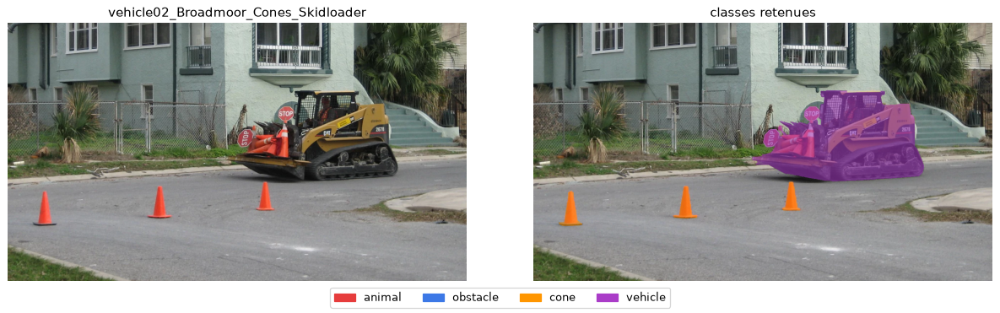
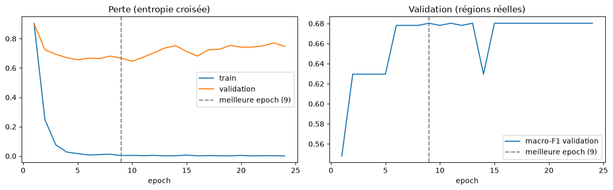
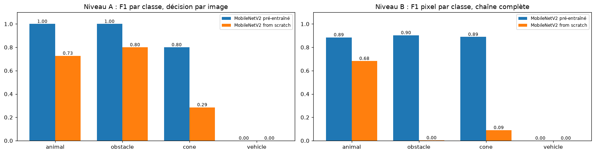
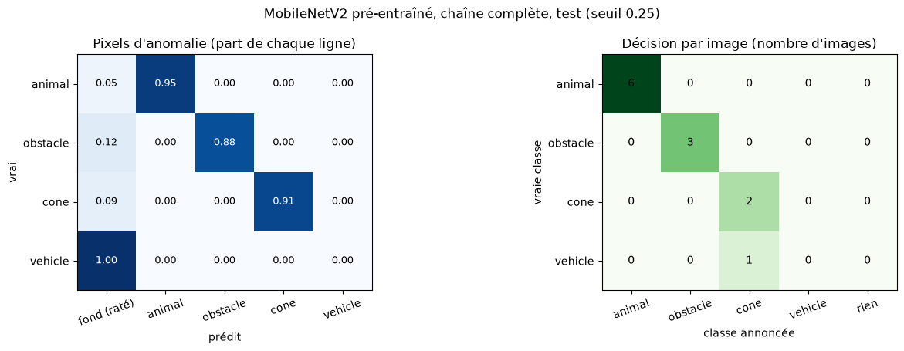
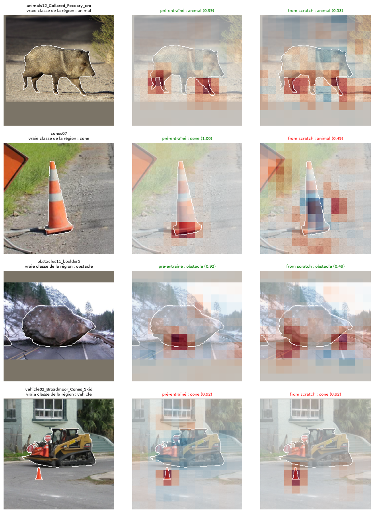

# Classification du type d'anomalie routière par MobileNetV2
### Projet Deep Learning RoadAnomaly · Objectif métier BO2 · Rapport individuel

| | |
|---|---|
| **Auteur** | Nour |
| **Objectif métier** | BO2 : réaction adaptée au type d'objet |
| **Modèles** | MobileNetV2 pré-entraîné (ImageNet) et MobileNetV2 from scratch |
| **Dépôt / branche** | `GhassenChaouch/RoadAnomaly` · `nour/bo2` |
| **Date** | 11 novembre 2026 |

---

## Résumé

Ce travail traite le deuxième objectif métier du projet : identifier le **type d'une anomalie routière** (animal, obstacle, cône, véhicule) afin d'adapter la réaction d'un système d'aide à la conduite. La solution repose sur une **chaîne en deux étapes** : le U-Net du BO1 localise les anomalies, puis un classifieur **MobileNetV2** attribue un type à chaque région détectée. MobileNetV2 a été choisi pour sa légèreté (2,2 M paramètres), adaptée à un système embarqué.

À architecture identique, le modèle **pré-entraîné sur ImageNet** classe correctement **11 images de test sur 12**, avec la localisation annotée comme avec la chaîne complète (macro-F1 pixel de **0,669**, contre 0,164 pour la référence). **Tous les pixels qu'il détecte reçoivent la bonne classe** : les erreurs restantes proviennent de la localisation. Le même réseau entraîné **from scratch** n'atteint que 5 images sur 12 dans la chaîne complète, ce qui démontre l'apport décisif du transfert d'apprentissage sur un jeu de 36 images d'entraînement. La classe *vehicle*, représentée par une seule région d'entraînement, n'est pas apprise. La classification ajoute environ 15 ms par région à la localisation.

---

## Sommaire
1. [Compréhension du problème métier](#1-compréhension-du-problème-métier)
2. [Compréhension et préparation des données](#2-compréhension-et-préparation-des-données)
3. [Démarche et protocole expérimental](#3-démarche-et-protocole-expérimental)
4. [Modélisation](#4-modélisation)
5. [Évaluation](#5-évaluation)
6. [Explicabilité (XAI)](#6-explicabilité-xai)
7. [Déploiement](#7-déploiement)
8. [Conclusion et perspectives](#8-conclusion-et-perspectives)
9. [Annexes](#9-annexes)

---

## 1. Compréhension du problème métier

### 1.1 Objectif
Une fois l'anomalie localisée sur la chaussée, le système doit **déterminer de quel type d'objet il s'agit**, car la réaction appropriée en dépend :

| Type | Caractéristique | Réaction attendue |
|---|---|---|
| Animal | peut se déplacer de façon imprévisible | ralentir, anticiper un mouvement |
| Obstacle (rocher, débris, pneu) | fixe, souvent massif | freiner ou contourner |
| Cône | signale un chantier | préparer un changement de voie |
| Véhicule | engin ou attelage sur la voie | alerte, ralentir |

### 1.2 Conséquences pour l'évaluation
- Une **erreur de type** entraîne une réaction inadaptée, même si l'obstacle est correctement détecté : la classe doit être évaluée, pas seulement la détection.
- Les classes sont **fortement déséquilibrées** (31 images d'animaux, 3 de véhicules). Le critère principal est donc le **F1 par classe**, résumé par le **macro-F1**, qui donne le même poids à chaque classe.
- La réaction se décide par image ou par objet : la **classe annoncée pour l'image** est également mesurée.
- Le système étant embarqué, la **taille du modèle** et le **temps d'inférence** font partie des critères.

### 1.3 Critères de succès
| Critère | Indicateur |
|---|---|
| Reconnaître le bon type | F1 par classe et macro-F1, par image et par pixel |
| Déclencher la bonne réaction | proportion d'images dont la classe annoncée est correcte |
| Distinguer erreur de type et erreur de localisation | comparaison localisation annotée / chaîne complète ; part des pixels détectés correctement classés |
| Réactivité et légèreté | nombre de paramètres, taille du fichier, temps CPU |

---

## 2. Compréhension et préparation des données

### 2.1 Jeu de données
Le jeu RoadAnomaly comprend **60 images routières** de 1280×720 pixels, chacune associée à un masque d'annotation pixel par pixel (fond / anomalie). L'exploration détaillée figure dans le notebook commun `poject.ipynb`. Le découpage commun de l'équipe (`split.csv` : 36 images d'entraînement, 12 de validation, 12 de test, stratifié par type et par taille d'anomalie, graine 42) est réutilisé et vérifié à chaque exécution.

### 2.2 Définition des classes
La classe de chaque image est déduite du préfixe de son nom de fichier, selon la même règle que l'autre approche BO2 de l'équipe (`bo2_classification.py`), afin de garantir la comparabilité : `animals*` → animal, `obstacles*` et `lost_tires*` → obstacle, `cones*` → cone, `vehicle*` → vehicle. **Le nom de fichier ne sert qu'à construire la cible** ; le modèle ne reçoit que les pixels de l'image.

| Classe | Images (train / val / test) | Régions (train / val / test) |
|---|---|---|
| animal | 19 / 6 / 6 | 22 / 9 / 10 |
| obstacle (dont 3 pneus) | 11 / 4 / 3 | 28 / 6 / 5 |
| cone | 5 / 1 / 2 | 21 / 4 / 6 |
| vehicle | **1** / 1 / 1 | **1** / 3 / 1 |

La classe *vehicle* ne compte qu'**une seule région d'entraînement** (`vehicle01`, un vélo chargé de foin) : elle ne peut pas être apprise de façon fiable. C'est la principale limite des données.

### 2.3 Unité de classification : la région
Une image contient souvent plusieurs objets éloignés (troupeau, cônes alignés, éboulis). Une boîte englobante unique couvrirait alors presque toute l'image. Le masque est donc découpé en **composantes connexes** : les fragments distants de moins de 15 px sont regroupés et les régions de moins de 150 px sont ignorées. **Chaque région est classée séparément.** Pour chaque région, on extrait un recadrage carré centré, avec 25 % de contexte de chaque côté, complété par du gris moyen hors de l'image, redimensionné en 224×224 et normalisé selon les statistiques ImageNet.

### 2.4 Cas particulier : `vehicle02`
L'image de test `vehicle02_Broadmoor_Cones_Skidloader` est la seule qui contienne **deux types d'objets annotés** : un engin de chantier (84 740 px) et trois cônes (2 710, 2 433 et 2 009 px). Le masque d'instances permet de les distinguer : les cônes reçoivent la classe *cone*, l'engin la classe *vehicle* ; la classe de l'image reste *vehicle*.


*Figure 1 : image `vehicle02` et classes retenues (cônes en orange, engin en violet).*

### 2.5 Augmentation de données
Appliquée à l'entraînement uniquement : décalage du cadre (±10 % du côté), changement d'échelle du cadre (0,8 à 1,4), symétrie horizontale, variations de luminosité et de contraste. Les variations du cadre imitent les régions imparfaites produites par la localisation automatique.

---

## 3. Démarche et protocole expérimental

### 3.1 Chaîne de traitement
```text
Image routière (1280×720)
      │
      ▼
[1] U-Net ResNet34 du BO1 ── où sont les anomalies ? ── masque prédit
      │
      ▼
Découpage en régions ── recadrage 224×224 par région
      │
      ▼
[2] MobileNetV2 ── quel type d'objet ? ── animal / obstacle / cone / vehicle
      │
      ▼
Carte de classes + classe annoncée pour l'image (vote pondéré par la surface)
```
Le U-Net du BO1 (`01_unet_pretrained.ipynb`) est réutilisé **sans réentraînement** : une seule localisation sert aux deux objectifs métier.

### 3.2 Protocole
| Élément | Choix |
|---|---|
| Échantillonnage | WeightedRandomSampler : chaque classe 25 %, chaque image pèse autant dans sa classe, chaque région autant dans son image ; 384 recadrages par epoch, batch de 32 |
| Fonction de perte | entropie croisée |
| Optimisation | AdamW (weight decay 1e-4), planning cosinus du learning rate |
| Durée | 60 epochs au maximum, arrêt anticipé après 15 epochs sans amélioration |
| Sélection du modèle | epoch au meilleur macro-F1 de validation |
| Seuil de localisation | choisi sur la validation (meilleur macro-F1 pixel de la chaîne), jamais sur le test |
| Reproductibilité | graine 42 fixée pour toutes les sources d'aléa |

### 3.3 Niveaux d'évaluation
- **Niveau A, localisation parfaite** : classification des régions issues des masques annotés. Il mesure la reconnaissance du type seule.
- **Niveau B, chaîne complète** : U-Net → régions prédites → MobileNetV2. Il reproduit la situation réelle d'une image envoyée à l'application.
- **Référence « classe majoritaire »** : mêmes pixels détectés, tous étiquetés *animal*. Elle indique ce que vaut la localisation sans aucune reconnaissance du type.

---

## 4. Modélisation

### 4.1 Choix de l'architecture
**MobileNetV2** est un réseau convolutif conçu pour les systèmes embarqués. Il repose sur des **convolutions séparables en profondeur** (un filtre par canal suivi d'une convolution 1×1), qui réduisent fortement le nombre de paramètres, et sur des **blocs résiduels inversés**, qui reprennent le principe des connexions résiduelles de ResNet. Il compte **2,2 M paramètres**, contre 11,2 M pour le ResNet18 utilisé dans l'autre approche BO2 de l'équipe, ce qui répond directement au critère de réactivité.

### 4.2 Modèles comparés
Les deux modèles partagent la même architecture et les mêmes réglages ; **seule l'initialisation diffère**. La comparaison isole ainsi l'apport du **transfert d'apprentissage**, selon la même démarche que celle appliquée au U-Net du BO1.

| | MobileNetV2 pré-entraîné | MobileNetV2 from scratch |
|---|---|---|
| Notebook | `BO2_mobilenetv2_pretrained.ipynb` | `BO2_mobilenetv2_scratch.ipynb` |
| Architecture | `torchvision.models.mobilenet_v2`, tête Dropout + Linear(1280, 4) | identique |
| Initialisation | poids ImageNet | aléatoire |
| Learning rate | 1e-4 (couches convolutives), 1e-3 (tête) | 1e-3 |
| Paramètres / fichier | 2,23 M / 9,2 Mo | 2,23 M / 9,2 Mo |
| Epoch retenue | 9 (arrêt à l'epoch 24, 8,5 min) | 12 (arrêt à l'epoch 27, 10,2 min) |
| Macro-F1 de validation | 0,680 | 0,446 |
| Seuil de localisation retenu | 0,25 | 0,70 |


*Figure 2 : courbes d'apprentissage du MobileNetV2 pré-entraîné (perte et macro-F1 de validation).*

---

## 5. Évaluation

Tous les résultats portent sur les **12 images de test**, jamais utilisées pour l'entraînement ni pour aucun choix.

### 5.1 Niveau A : localisation parfaite
| Modèle | Images bien classées | Macro-F1 image | Régions bien classées | F1 animal | F1 obstacle | F1 cone | F1 vehicle |
|---|---|---|---|---|---|---|---|
| **MobileNetV2 pré-entraîné** | **11/12** | **0,700** | **19/22** | **1,000** | **1,000** | **0,800** | 0,000 |
| MobileNetV2 from scratch | 7/12 | 0,453 | 13/22 | 0,727 | 0,800 | 0,286 | 0,000 |

### 5.2 Niveau B : chaîne complète
| Modèle | Macro-F1 pixel | F1 animal | F1 obstacle | F1 cone | F1 vehicle | Images bien classées | Pixels détectés bien classés | Dice détection |
|---|---|---|---|---|---|---|---|---|
| **MobileNetV2 pré-entraîné** | **0,669** | **0,885** | **0,903** | **0,889** | 0,000 | **11/12** | **100 %** | 0,846 |
| MobileNetV2 from scratch | 0,194 | 0,683 | 0,003 | 0,090 | 0,000 | 5/12 | 43,2 % | 0,848 |
| Référence classe majoritaire | 0,164 | 0,655 | 0 | 0 | 0 | 6/12 | 57,7 % | 0,846 |


*Figure 3 : F1 par classe des deux modèles, au niveau A (gauche) et au niveau B (droite).*

**Analyse**
- La localisation est identique pour les deux modèles (Dice de détection de 0,85) : **les écarts proviennent uniquement de la classification.**
- Le **modèle pré-entraîné** obtient 11/12 aux deux niveaux et atteint un F1 de 0,89 en moyenne sur les classes animal, obstacle et cone. **Tous les pixels qu'il reçoit sont correctement classés** : ses erreurs résiduelles proviennent de pixels non détectés par la localisation.
- Le **modèle from scratch** reste proche de la référence (macro-F1 de 0,194 contre 0,164) et classe moins bien les images (5/12) qu'une règle constante (6/12). Il confond principalement cônes, obstacles et animaux. Ses performances baissent de 7/12 à 5/12 entre les niveaux A et B : un classifieur peu robuste est sensible aux régions imparfaites issues de la localisation.


*Figure 4 : matrices de confusion du MobileNetV2 pré-entraîné, chaîne complète (pixels à gauche, images à droite).*

### 5.3 Analyse de l'erreur principale : `vehicle02`
- **Niveau B** : l'engin de chantier n'est pas détecté par le U-Net (rappel de détection de 0,076). Seuls les trois cônes sont détectés et correctement classés *cone* ; l'image est donc annoncée *cone* au lieu de *vehicle*.
- **Niveau A** : même avec le masque annoté, la région de l'engin (fusionnée avec un cône voisin lors du regroupement des fragments) est classée *cone*. L'engin appartient à un type absent de l'apprentissage, et l'analyse d'explicabilité (section 6) montre que la décision repose sur le cône.

### 5.4 Taille et temps d'inférence (CPU)
| Modèle | Paramètres | Fichier | Classification d'une région | Chaîne complète par image |
|---|---|---|---|---|
| MobileNetV2 pré-entraîné | 2,2 M | 9,2 Mo | environ 17 ms | environ 253 ms |
| MobileNetV2 from scratch | 2,2 M | 9,2 Mo | environ 15 ms | environ 230 ms |

La chaîne complète est dominée par la localisation (environ 190 ms par image pour le U-Net, 24,4 M paramètres). La classification n'ajoute qu'**environ 15 ms par région** : lorsque la localisation du BO1 est déjà calculée, le coût du BO2 est marginal. Les deux modèles ayant la même architecture, leur écart de temps n'est pas significatif ; les mesures, réalisées sur une machine à deux cœurs, varient avec sa charge.

### 5.5 Discussion et limites
1. **Transfert d'apprentissage.** À architecture égale, le pré-entraînement fait passer la chaîne complète de 5 à 11 images bien classées et le macro-F1 pixel de 0,194 à 0,669. Avec 36 images d'entraînement, l'apprentissage de filtres visuels depuis une initialisation aléatoire est insuffisant.
2. **Classe *vehicle*.** Une seule région d'entraînement ne permet pas d'apprendre cette classe. Un mécanisme de rejet (« objet inconnu ») ou des données supplémentaires sont nécessaires.
3. **Taille des ensembles.** La validation ne compte qu'une image de cône et une de véhicule ; l'epoch retenue correspond à un pic de validation, dont le score est optimiste. Le test ne compte que 12 images : seuls les écarts nets (pré-entraîné / from scratch, modèles / référence) sont interprétables.
4. **Étiquetage.** L'hypothèse « une classe par image » est exacte pour 59 images sur 60 (l'exception, `vehicle02`, est traitée). Des personnes non annotées détectées par la localisation sont comptées comme fausses alertes.
5. **Localisation partielle.** Lorsqu'un objet n'est que partiellement détecté, le classifieur reçoit un fragment peu représentatif ; l'amélioration de la localisation (BO1) bénéficierait directement au BO2.
6. **Poids utilisés.** La localisation utilise une copie réentraînée du U-Net du BO1 (notebook `01_unet_pretrained.ipynb` exécuté à l'identique ; Dice de test 0,850). Les poids ImageNet de MobileNetV2 proviennent d'une version équivalente publiée sur GitHub (même architecture), le serveur de téléchargement de PyTorch n'étant pas accessible depuis la machine d'exécution. Une nouvelle exécution avec les poids officiels de torchvision peut produire des résultats légèrement différents.

---

## 6. Explicabilité (XAI)

### 6.1 Méthode
L'analyse vérifie si la décision de classe repose sur l'objet ou sur le décor (route de campagne, chantier, ville). La méthode est un **test d'occlusion**, identique à celle du BO1 : un carré gris de 32×32 pixels (pas de 16) masque successivement chaque zone du recadrage 224×224, et l'on mesure la baisse de probabilité de la classe annoncée. L'indicateur est le **rapport entre la part de la sensibilité située sur l'objet et la part de surface de l'objet** ; un rapport de 1 correspond à une attention répartie au hasard. Notebook : `BO2_mobilenetv2_xai.ipynb`.

### 6.2 Résultats
| Modèle | Part de la sensibilité sur l'objet | Surface moyenne de l'objet | Rapport médian (min à max) | Images au niveau du hasard (rapport < 1,2) |
|---|---|---|---|---|
| Pré-entraîné | 0,33 | 0,15 | **1,82** (0,66 à 6,35) | `animals14`, `vehicle02` |
| From scratch | 0,24 | 0,15 | 1,40 (0,36 à 4,78) | `animals19`, `animals30`, `cones07` |


*Figure 5 : cas d'étude. Recadrage avec le contour de l'objet (gauche), sensibilité du modèle pré-entraîné (centre) et du modèle from scratch (droite) ; en rouge, les zones dont dépend la décision.*

### 6.3 Interprétation
- Le **modèle pré-entraîné s'appuie davantage sur l'objet**, en particulier sur sa **base, au contact de la chaussée** : pattes de l'animal, pied du cône, bas du rocher. Les rapports les plus élevés concernent `animals30` (6,35) et `cones07` (4,45).
- Le **modèle from scratch disperse son attention dans le décor** : pour `cones07`, qu'il classe *animal*, la sensibilité couvre l'herbe et le panneau autant que le cône (rapport de 0,55).
- Pour `vehicle02`, la décision *cone* (confiance 0,92) dépend du cône situé devant l'engin, et non de l'engin lui-même (rapport de 0,66) : le modèle reconnaît l'objet connu présent dans le cadre et ignore l'objet inconnu.
- Le pré-entraînement améliore donc à la fois les performances et la pertinence des indices utilisés.

**Précautions** : l'occlusion révèle une dépendance, pas une causalité ; le carré gris est hors de la distribution d'apprentissage ; le recadrage inclut 25 % de contexte par construction ; lorsque la confiance est proche de 1, les variations sont faibles et l'indicateur plus bruité ; douze images ne permettent pas de généraliser.

---

## 7. Déploiement

Le modèle retenu pour l'onglet BO2 de l'application est le **MobileNetV2 pré-entraîné** (`bo2_mobilenetv2_pretrained_best.pt`, 9,2 Mo), placé après le U-Net du BO1.

| Paramètre | Valeur |
|---|---|
| Seuil de localisation | 0,25 (choisi sur la validation) |
| Seuil de rejet « objet inconnu » | confiance inférieure à 0,5 (valeur proposée, à ajuster sur un ensemble de validation plus large) |
| Sortie affichée | image, régions colorées par classe (animal rouge, obstacle bleu, cône orange, véhicule violet) avec leur confiance, classe annoncée pour l'image et réaction associée |
| Coût supplémentaire | environ 15 ms par région détectée |

Le seuil de rejet permet de signaler un objet hors des classes apprises plutôt que de lui attribuer une classe erronée, ce qui rendrait visible le cas de l'engin de chantier.

---

## 8. Conclusion et perspectives

| Critère | MobileNetV2 pré-entraîné | MobileNetV2 from scratch |
|---|---|---|
| Images bien classées, localisation parfaite | **11/12** | 7/12 |
| Images bien classées, chaîne complète | **11/12** | 5/12 |
| Macro-F1 pixel, chaîne complète | **0,669** | 0,194 |
| Paramètres / fichier | 2,2 M / 9,2 Mo | 2,2 M / 9,2 Mo |

Le MobileNetV2 pré-entraîné répond à l'objectif métier : il identifie correctement le type d'anomalie pour 11 images de test sur 12, sans erreur de classe sur les régions qu'il reçoit, pour un coût d'environ 15 ms par région et un modèle de 9,2 Mo. Le pré-entraînement ImageNet est décisif à architecture égale. Les limites principales concernent les données (classe *vehicle* quasi absente, test de 12 images) et la localisation des objets petits, lointains ou inconnus.

**Perspectives**
1. **Comparer les deux approches BO2 de l'équipe** : le notebook `BO2_mobilenetv2_comparaison.ipynb` évalue automatiquement ResNet18 et le CNN simple de `bo2_classification.py` dès que ces fichiers et leurs poids sont disponibles, avec leur propre code, aux deux niveaux.
2. **Compléter les données** de la classe *vehicle* ou la remplacer par un rejet « objet inconnu ». L'image `vehicle02` constitue également un cas d'étude pertinent pour le BO3 (objets jamais vus).
3. **Affiner la sortie** : ignorer les très petites régions ou leur attribuer la classe majoritaire de l'image, avec un seuil de taille choisi sur la validation.
4. **Évaluer systématiquement la chaîne complète** : la localisation parfaite surestime les performances d'un classifieur peu robuste.

---

## 9. Annexes

### A. Liens avec le cours
| Notion | Application |
|---|---|
| Entropie croisée multi-classe, softmax (chap. 2) | fonction de perte et sortie à 4 classes |
| Adam, weight decay, Dropout, early stopping (chap. 3) | AdamW, Dropout de la tête, arrêt anticipé |
| Réseaux convolutifs, connexions résiduelles, transfert d'apprentissage (chap. 4) | MobileNetV2, comparaison pré-entraîné / from scratch |
| Recherche d'hyperparamètres (chap. 3) | learning rates, seuil de localisation, échantillonnage équilibré |

### B. Fichiers et reproduction
Les notebooks s'exécutent depuis `RoadAnomaly\RoadAnomaly` avec l'environnement du dépôt et ne contiennent aucun chemin absolu.

| Fichier | Rôle |
|---|---|
| `bo2_mobilenet_commun.py` | code commun : classes, régions, recadrages, métriques, chaîne de traitement |
| `BO2_mobilenetv2_pretrained.ipynb` | entraînement et évaluation du modèle pré-entraîné (environ 10 min sur CPU) |
| `BO2_mobilenetv2_scratch.ipynb` | entraînement et évaluation du modèle from scratch (environ 10 min) |
| `BO2_mobilenetv2_comparaison.ipynb` | comparaison, interprétations et conclusion ; intégration optionnelle de l'autre approche BO2 |
| `BO2_mobilenetv2_xai.ipynb` | test d'occlusion |
| `outputs_bo2_mobilenetv2_*` | figures, tableaux et résultats (`resultats_bo2.json`) ; poids `.pt` non versionnés |

**Prérequis** : le fichier de poids du U-Net du BO1, `outputs_unet_resnet34_pretrained/unet_resnet34_pretrained_best.pt` (non versionné), pour l'évaluation de la chaîne complète. En son absence, seul le niveau A est calculé. L'option `QUICK_TEST = True` permet une vérification rapide de la chaîne ; ses résultats ne sont pas rapportés.
